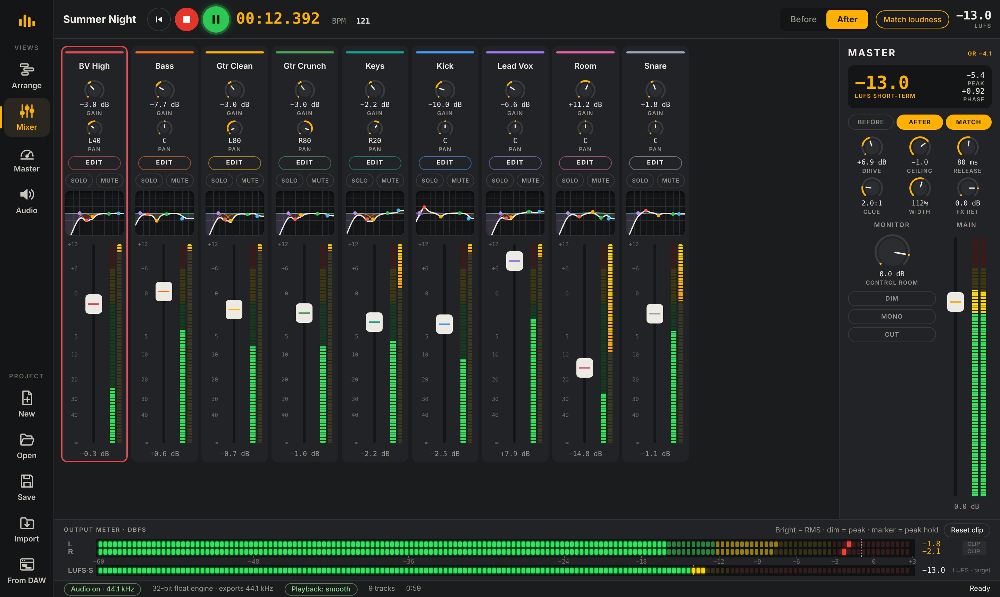

# AutoMix Studio

AI mixing and mastering in the browser. Drop in your multitracks, press **AUTO MIX**, and export a finished MP3 or WAV.

## What it does
- Recognises each instrument and builds a full chain: clean-up (denoise, gate, de-ess, hum), EQ, compression, reverb and delay
- Pans doubled parts left and right, puts the lead vocal on top, tames room mics
- 20 mix styles (Pop, Rock, Metal, Hip-Hop, Trap, EDM, Mizrahi, Jazz …)
- Mastering to a loudness target (Spotify −14, Apple Music −16, Loud −11, Club −9)
- Opens Cubase (.dawproject), Ableton Live (.als), Logic Pro and Pro Tools (AAF) sessions, and sends processed tracks back

## Files
| File | What it is |
|---|---|
| `index.html` | Landing page |
| `app.html` | The app — one self-contained file |
| `assets/` | Screenshots used by the landing page |
| `media/` | Marketing kit: Instagram reel, Instagram post, A4 flyer |

## Media kit
| File | Format | Use |
|---|---|---|
| [`media/automix-reel.mp4`](media/automix-reel.mp4) | 1080×1920 · 26 s · H.264 + AAC 320 kbps | Instagram / TikTok / Shorts reel, with an original rock soundtrack |
| [`media/instagram-post.png`](media/instagram-post.png) | 1080×1350 | Instagram feed post |
| [`media/flyer-a4.pdf`](media/flyer-a4.pdf) · [`png`](media/flyer-a4.png) | A4 | Print flyer with QR code to the site |

The reel's music is an original composition synthesised from scratch for this video — no samples or third-party audio.

## Publish with GitHub Pages
1. Upload all files in this folder to the root of a new repository (keep `assets/` as a folder).
2. **Settings › Pages** → *Source: Deploy from a branch* → branch `main`, folder `/ (root)` → **Save**.
3. After a minute the site is live at `https://<your-user>.github.io/<repo>/` — the landing page, with the app at `/app.html`.

## Run locally
Open `app.html` in Chrome or Edge. Everything runs in the browser; audio never leaves your computer.

© 2026 AD SOUND & SERVICE
